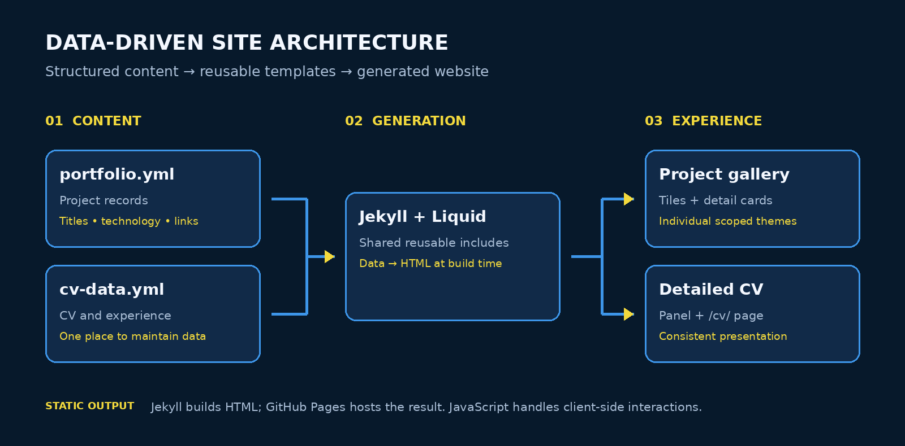

<div align="center">

# PORTFOLIO WEBSITE

### A data-driven portfolio, designed to scale.

**YAML-Powered Content · Reusable Templates · Themed Projects · Interactive CV**

[](https://jekyllrb.com/)
[](https://pages.github.com/)
[](https://developer.mozilla.org/en-US/docs/Web/JavaScript)
[](https://sass-lang.com/)

**[Explore the Live Website](https://jawadkachbal.com/)** · **[Browse the Source](https://github.com/PilotDevNull/Portfolio-Website)**

---

*A content-first, data-driven portfolio built with Jekyll, YAML and reusable Liquid components—combining maintainable architecture with animated navigation and individually themed project showcases.*

</div>

## ✦ Overview

This repository contains my personal portfolio website: a central place for my software projects, technical interests, experience and curriculum vitae. The site uses a **single-page, sliding-panel interface** with a video-backed landing screen, a **project grid**, full project detail views and a **Detailed CV** that can also be opened directly at [`/cv/`](https://jawadkachbal.com/cv/).

**The defining feature is its data-driven architecture.** Rather than hardcoding every project card or résumé entry, I separate the content from the presentation: project records and CV information live in structured YAML files, and shared Jekyll/Liquid templates generate the corresponding interface. Adding or editing a project typically means changing data, not duplicating page markup or rewriting JavaScript. Each project can still have its own visual identity through scoped CSS.

## ✦ Why data-driven?

**One structured source of truth, multiple consistent views.** The same project record supplies information to the portfolio gallery, its dedicated detail panel, and the shared presentation components. CV content follows a similar model. This is the engineering decision behind the website—not simply a convenience for updating text.

| Traditional hardcoded portfolio | This portfolio |
|:--|:--|
| Project content repeated across HTML views | Project details maintained in a YAML entry |
| New entries require copying page structures | Liquid templates render new entries using the shared layout |
| Styling and content mixed together | Structured data, reusable presentation and scoped project themes |
| Updating many entries risks visual inconsistency | Shared components preserve the same structure across projects |

**The workflow:** structured YAML content is consumed by reusable Jekyll/Liquid templates, which generate consistent static pages. Project-scoped CSS then gives each card its own visual identity.

The site remains statically generated: the YAML is processed during the Jekyll build, not fetched from a database at runtime. This keeps hosting simple and page delivery lightweight while still providing many of the maintenance benefits of a content management system.

## ✦ Design philosophy

| Principle | How it appears in the website |
|:--|:--|
| **Visual identity** | Navy and royal-blue interface, translucent overlays and clean typography |
| **Individuality** | Project-specific colours and card styling tailored to each project's artwork |
| **Navigation** | Animated panels, a responsive project gallery and direct links to details |
| **Readability** | Two-column CV-style layouts with a project-artwork sidebar and scrollable content |
| **Data-driven by design** | YAML as the content source; reusable Liquid templates generate consistent project and CV views |
| **Lightweight interaction** | Vanilla JavaScript for navigation, carousels and image modals |

## ✦ Features

- **Data-driven content architecture** — update projects and CV entries in YAML; reusable Liquid includes produce the interface.
- **Animated landing page** — full-screen background video, profile details and quick-access navigation.
- **Project gallery** — responsive tiles with cover artwork and click-through detail panels.
- **Themed project cards** — each project can have its own colours and styling, while using the same reusable layout.
- **Detailed project write-ups** — technologies, design decisions, contributions, results and source links.
- **Integrated CV** — detailed CV panel within the site plus a standalone, linkable CV page.
- **Responsive layouts** — adaptable navigation and project views on desktop and mobile.
- **Image viewing** — modal image display for supported galleries.
- **Visitor analytics** — Cloudflare Web Analytics integrated into site layouts.

## ✦ Technology stack

| Layer | Technology | Role |
|:--|:--|:--|
| Static site generation | **Jekyll + Liquid** | Pages, reusable templates and content rendering |
| Content | **YAML** | Project and CV data |
| Styling | **CSS / SCSS / Sass** | Responsive layout, animations and project themes |
| Interactivity | **Vanilla JavaScript** | Sliding panels, navigation, carousel and modal behaviour |
| Icons | **Font Awesome Free** | Interface and link icons |
| Analytics | **Cloudflare Web Analytics** | Visitor statistics |
| Hosting | **GitHub Pages** | Static hosting and deployment |
| Domain | **Custom domain** | [`jawadkachbal.com`](https://jawadkachbal.com/) |

## ✦ Site architecture

<div align="center">
  
</div>

### Repository map

```text
Portfolio-Website/
├── _data/
│   ├── portfolio.yml        # Project entries
│   └── cv-data.yml          # CV content
├── _includes/               # Shared components and panel templates
│   ├── portfolio-projects.html
│   ├── portfolio-index.html
│   └── styles.html          # Interface and individual card styling
├── _layouts/                # Page layouts
├── _sass/                   # Sass partials
├── assets/                  # Site assets, including README architecture graphic
├── images/                  # Project covers and images
├── js/                      # JavaScript assets
├── css/                     # Stylesheets
├── cv/                      # Standalone CV page
├── index.html               # Site entry point
├── _config.yml              # Jekyll configuration
├── Gemfile                  # Ruby dependencies
└── CNAME                    # Custom domain
```

## ✦ Adding and maintaining projects

The portfolio is designed so that **a single YAML project entry drives the gallery tile and its detail view**.

**1. Add the images** under `images/projects/` using the project's unique slug:

```text
images/projects/<slug>.jpg         # Grid image and mobile hero
images/projects/<slug>-inside.jpg  # Desktop hero artwork
```

**2. Add a project entry** to `_data/portfolio.yml`:

```yaml
- slug: example-project
  title: Example Project
  subtitle: A short project description
  meta: Personal Project &middot; 2026
  accent: "#0B5294"
  links:
    - href: "https://github.com/your-account/example-project"
      icon: fab fa-github
      title: View on GitHub
  technologies:
    - "Python"
    - "JavaScript"
  body: |
    <p>Introduce the project, its purpose and the approach.</p>
    <h4 class="cvstyle-subhead">My contribution</h4>
    <p>Describe your implementation and key decisions.</p>
```

**3. Commit and push.** Liquid templates in `_includes/portfolio-projects.html` and `_includes/portfolio-index.html` read the entry to generate the project UI. The navigation lookup in `_includes/header.html` is also data-driven.

### Project-specific styling

Each project has a base `accent` colour supplied through YAML. For richer themes—such as distinct sidebar backgrounds, heading treatments, dividers and border colours—its styles can be scoped in `_includes/styles.html` to its section ID.

```css
/* Example: affects only one project */
#example-project-section .cvstyle-sidebar {
  background: linear-gradient(155deg, #112A48, #0B1C30);
}

#example-project-section .cvstyle-sidebar-heading {
  color: #F2D93D;
}
```

> **Note:** Additional nested YAML `theme:` keys do not automatically change the page unless the template and CSS explicitly support them. The current card-specific styling approach uses CSS selectors scoped to individual project sections.

### Updating CV content

Edit `_data/cv-data.yml` to change experience, education, projects, skills and other résumé information. CV sections are rendered through reusable includes. Fields that use Markdown rendering can contain basic Markdown formatting.

## ✦ Run locally

**Requirements:** Ruby, Bundler and a supported Jekyll environment. On Windows, Ruby with DevKit is recommended.

```bash
git clone https://github.com/PilotDevNull/Portfolio-Website.git
cd Portfolio-Website
bundle install
bundle exec jekyll serve
```

Open **http://127.0.0.1:4000/** in a browser. Jekyll watches for changes and rebuilds during development.

On Windows, if a native Ruby gem fails to compile during installation, run `ridk install` to set up the necessary MSYS2/MinGW toolchain and retry.

## ✦ Deployment

The website is hosted with **GitHub Pages** and uses the custom domain [`jawadkachbal.com`](https://jawadkachbal.com/). Changes are committed and pushed to the `main` branch through the repository's deployment workflow.

```bash
git add -A
git commit -m "Update portfolio content and styles"
git push origin main
```

For Windows contributors, setting `git config core.autocrlf true` before working on the repository can help avoid unwanted line-ending changes.

## ✦ Credits and attribution

The website originated from the **jekyll-uno** theme by **Josh Gerdes**, later adapted as **jekyll-uno-timeline** by **Thomas Zühlke**. Its current panels, project carousel, project themes, layout modifications and CV integration are customised for this portfolio.

The standalone CV draws on the **Orbit résumé template** by **Xiaoying Riley**, licensed under Creative Commons Attribution 3.0. Interface icons use **Font Awesome Free**.

## ✦ Licence

The repository's source code is distributed under the **MIT License**; see [`LICENSE`](LICENSE).

**Original written content, photography and original artwork are © 2026 Jawad Kachbal. All rights reserved.**

---

<div align="center">

**Data defines the content. Templates shape the experience. Each project keeps its identity.**

[🌐 Live Portfolio](https://jawadkachbal.com/) · [⌘ Source Code](https://github.com/PilotDevNull/Portfolio-Website)

</div>
